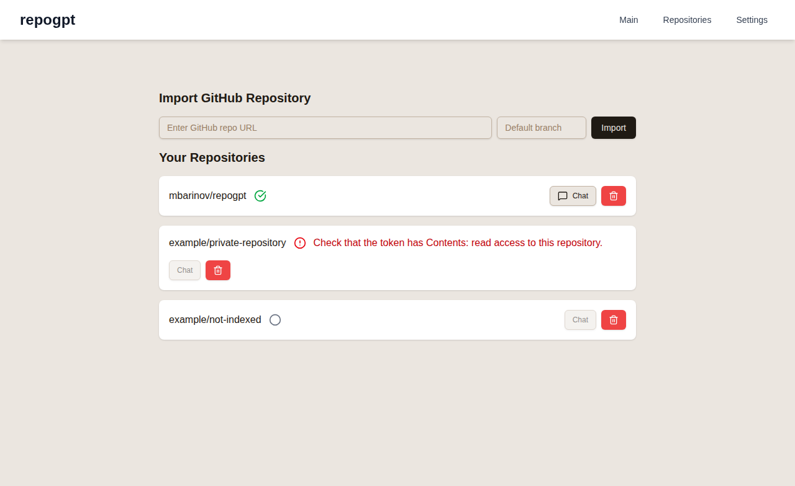
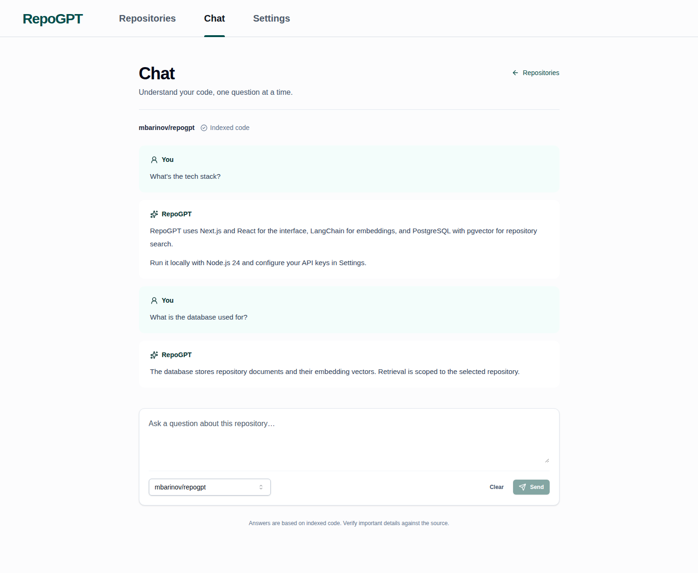
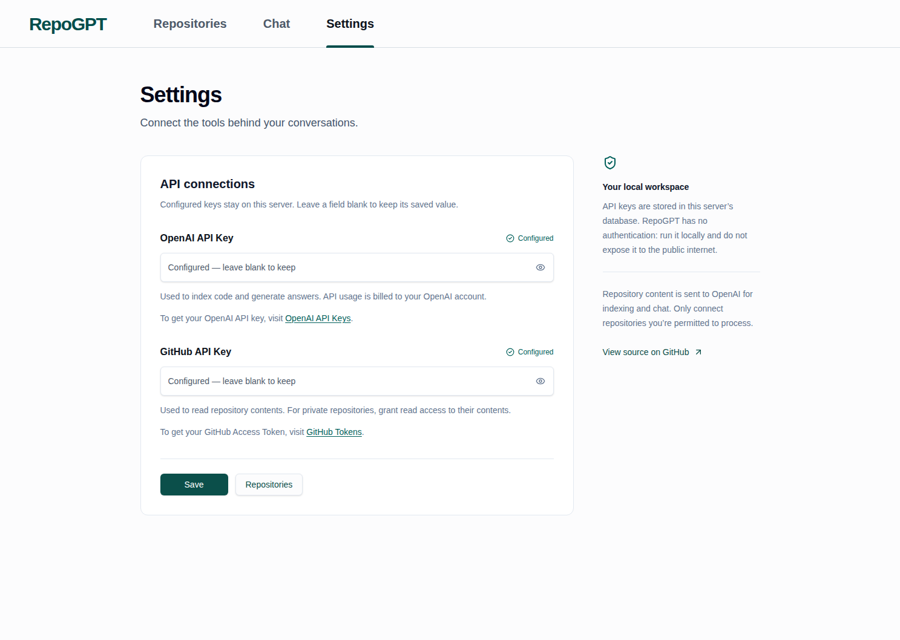

# RepoGPT

[](https://github.com/mbarinov/repogpt/actions/workflows/ci.yml)
[](LICENSE)

Chat with a GitHub codebase. RepoGPT imports source files and useful configuration, splits them into chunks, and stores OpenAI embeddings in PostgreSQL with pgvector. Questions combine semantic and lexical retrieval, then stream an answer with source links grounded in the retrieved repository snapshot.

Built with Next.js, React, Vercel AI SDK, LangChain, and Prisma. Designed for **one person running it locally**, not as a public hosted service.

## Screenshots

Actual browser captures of the running app, using synthetic test repositories and mocked chat responses. No real credentials or live OpenAI calls are used. [Capture provenance and checks](docs/ui-verification.md).

### Repository library

Select a repository to see its indexing status, open a chat, or manage its local index.



### Repository chat



### Settings



Mobile captures: [repository library](docs/images/repositories-mobile.png) · [chat](docs/images/chat-mobile.png) · [settings](docs/images/settings-mobile.png).

## Quick start

Requirements: **Node.js 24**, **pnpm 12.16.1**, Docker with Compose, and an OpenAI API key. Imports and chat make paid OpenAI requests; your provider's charges apply.

```sh
git clone https://github.com/mbarinov/repogpt.git
cd repogpt
npm install --global pnpm@12.16.1
cp .env.example .env
pnpm install --frozen-lockfile
docker compose up -d --wait
pnpm db:generate
pnpm db:migrate
pnpm dev
```

Open [http://127.0.0.1:3000](http://127.0.0.1:3000). The app and the Compose database bind to loopback by default.

1. In **Settings**, save your OpenAI key and GitHub token.
2. For a fine-grained GitHub token, select the repositories you want to import and grant **Contents: Read-only**. Organization repositories may require owner approval. Never grant write access just for RepoGPT.
3. In **Repositories**, choose **Import repository**, enter a GitHub URL and optional branch, then select **Import**. Keep the dialog open until indexing completes; a successful import is not reported before indexing finishes.
4. Select a ready repository and choose **Open chat**. Suggested questions fill the message box; they never send a request until you submit.

Settings inputs intentionally stay blank after saving. Leaving an input blank preserves its existing credential; stored credentials are never sent back to the browser.

For a production-mode **local** run:

```sh
pnpm build
pnpm start
```

### Database and upgrades

Compose pins an official `pgvector/pgvector` image with PostgreSQL 17 and pgvector 0.8.7, and stores data in the `repogpt-data` volume. `docker compose down` preserves that volume; **`docker compose down -v` deletes it**.

If using an existing PostgreSQL server, install pgvector and set `DATABASE_URL` in `.env`. The migration role must be able to create the `vector` extension (or have an administrator create it first).

Before upgrading an existing installation, back up your database. Install with the committed lockfile, regenerate the Prisma client, and apply committed migrations with `pnpm db:migrate`. Do not replace this with `prisma db push`: the migration history includes the vector extension and relationship changes. Do not point the Compose volume at data from a different PostgreSQL major version; use PostgreSQL's supported upgrade or dump/restore procedure.

## Privacy and limitations

- **No authentication or tenant isolation.** Anyone who can reach the app can change settings, import/delete repositories, and use your API key. Do not expose it through a public IP, port-forward, shared reverse proxy, or public preview URL.
- Credentials are stored **unencrypted in the local database**. Protect the database, its volume and backups; use least-privilege tokens. Loopback binding is not a substitute for authentication on a shared or untrusted machine.
- Repository text is sent to OpenAI for embeddings; retrieved excerpts and conversation messages are sent for answers. Only import code you are authorized to share with that provider.
- Repository content is untrusted data, not model instructions. Separating it from the system prompt reduces instruction confusion, but model output can still be wrong or manipulated. Review suggested code before using it.
- Imports run within an HTTP request, not a durable job queue. Imports are limited to 2,000 eligible files, 10 MB of source and 10,000 chunks; individual files over 256 KB are skipped. A process restart can leave an import marked as loading: delete that entry and import again. Run this on a long-lived local Node server, not a short-timeout serverless function. This is not a distributed indexing service.
- Generated files, dependencies, binaries and lockfiles are excluded. Source, documentation, package manifests and workflow configuration are useful context. The answer is not a full static analysis of the repository.
- OpenAI is the supported provider. The older experimental Ollama pull request is not part of this release.

## Source-aware indexing and search

TS/JS chunks follow declaration boundaries, Markdown follows sections, and other formats use a bounded fallback. Source paths and original line ranges point to the exact indexed commit. Hybrid PostgreSQL search combines embeddings with exact identifier/path/error-text lookup; it does not require another search service.

Existing indexes remain searchable after migration. They cannot gain accurate source links retroactively: refresh a repository to rebuild its provenance. Legacy excerpts are explicitly labeled, never given fabricated locations. See [retrieval and migration notes](docs/grounded-retrieval.md) for limits, trade-offs and test evidence.

## Development and checks

See [CONTRIBUTING.md](CONTRIBUTING.md) for test commands and fixture boundaries, and [upgrade notes](docs/modernization.md) for dependency choices. The CI workflow checks lint, types, tests, migrations, a production build and browser flows. Tests use mocked external APIs, not live OpenAI credentials.

## Support

[Report a bug](https://github.com/mbarinov/repogpt/issues) with reproduction steps and sanitized logs. Never attach API keys, private source, or database dumps. For sensitive reports, email [me@maxbarinov.com](mailto:me@maxbarinov.com).

[MIT](LICENSE) · [Max Barinov](https://maxbarinov.com)
